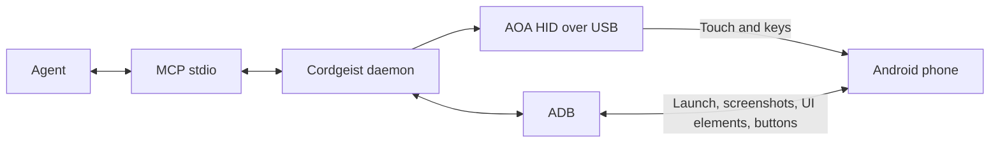

<div align="center">
<h1>Cordgeist</h1>
<p>Give AI agents real hands on an Android phone over USB.</p>
<a href="LICENSE"></a>
<a href="https://github.com/outlierstudio/cordgeist"></a>
</div>

**Taps and keystrokes arrive as a physical USB touchscreen and keyboard.** **Cordgeist registers external AOA HID devices, so touch and typing enter Android through its input-device path rather than framework event injection.**
Navigate apps and Settings without root or an app installed on the phone. HID may help where apps filter injected input; behavior in those apps is not yet verified.

<!-- demo -->
Recordings pending; these are example workflows, not completed demo claims.

**"open settings and turn on dark mode"**
<!-- demo: dark-mode.mp4 -->

**"launch 5 apps as fast as you can"**
<!-- demo: five-apps.mp4 -->

**"type a message in the search bar"**
<!-- demo: typing.mp4 -->

> [!IMPORTANT]
> Requires a **Linux x86_64 host** and an unlocked Android phone over USB with USB debugging authorized.
> Only the **Galaxy Note 9 (Android 10, portrait)** has been tested. Other phones are untested.

After [building](#install), run from the checkout:
```sh
CG="$PWD/target/release/cordgeist"                       # Native executable
RUNTIME="$HOME/.local/state/cordgeist"                  # Shared CLI/MCP runtime
install -d -m 700 "$RUNTIME"                            # User-owned runtime directory
"$CG" --runtime "$RUNTIME" setup                        # Select the single phone; generic mapping
"$CG" --runtime "$RUNTIME" doctor --json                # Read-only checks; no tap
"$CG" --runtime "$RUNTIME" list                         # Inspect discovery
realpath "$CG"                                        # Copy this absolute path into client config
# Optional: open the owned synthetic page as described in docs/cli.md first.
# "$CG" --runtime "$RUNTIME" setup calibrate --verify    # Explicit target verification and saved profile
# "$CG" --runtime "$RUNTIME" daemon stop                # Stop after closing agent sessions
```



## Features

- **Measured mapping:** maximum Android-mapped error **1.343 px over 9 points** on a Galaxy Note 9; optional calibration, generic mapping by default.
- **US-ANSI keyboard typing:** ASCII through HID; owner-reported short typing sample **0.219 s**, a single earlier result, not a benchmark.
- **Touch and swipes:** element-center clicks, coordinate taps, directional swipes and legacy holds.
- **App control and observation:** common-name/package launch, UI elements and explicit screenshots; actions skip automatic after-images.
- **Typed receipts:** `sent`, `partial`, `not-sent` or `unknown`; delivery is separate from application success.
- **Exclusive ownership:** one owner lease per phone, managed inside each MCP session.
- **Real agent acceptance:** owner-reported Cursor run: **11 tool calls, 0 errors**, Bluetooth read without toggling, then hand-back.

These are earlier development results, not fresh hardware acceptance of this source snapshot. See [measurement scope](docs/measurements.md).

## Install

Build from source with Rust **1.97.1**, CMake ≥3.20, a C++20 compiler, Ninja, pkg-config, and matching **libusb headers/runtime ≥1.0.30**. Install Google platform-tools `adb` separately and put it on PATH. Build scripts do not fetch dependencies; Cargo needs its locked crates available.

```sh
git clone https://github.com/outlierstudio/cordgeist.git
cd cordgeist
./scripts/build-native.sh
AOAHID_LIB_DIR="$PWD/build/native-prefix/lib" cargo build --release --locked --features native-aoa
```

This build uses the host's libc; it is not a portable binary promise. See [dependencies](docs/dependencies.md) and [portable build requirements](packaging/PORTABLE-BUILD.md).
For USB permission errors, review and explicitly install the scoped [udev rule](packaging/UDEV.md). Its normal-mode ID covers the tested Samsung; other IDs need a local rule. No silent sudo or driver changes.

## Use it with an agent

Run setup first. Replace both absolute paths below with the executable printed above and your runtime directory. JSON/TOML examples do not expand `$HOME`. Use one client at a time and close stale MCP connections. Only Cursor has recorded real-agent acceptance; the other formats are documentation-verified configurations.

### Cursor

Merge into `.cursor/mcp.json` or `~/.cursor/mcp.json` ([format](https://cursor.com/docs/mcp)):
```json
{"mcpServers":{"cordgeist":{"type":"stdio","command":"/absolute/path/cordgeist/target/release/cordgeist","args":["--runtime","/absolute/path/cordgeist-runtime","mcp"]}}}
```

### Claude Code

Merge into the project's `.mcp.json` ([format](https://code.claude.com/docs/en/mcp)) and approve the server when prompted:
```json
{"mcpServers":{"cordgeist":{"type":"stdio","command":"/absolute/path/cordgeist/target/release/cordgeist","args":["--runtime","/absolute/path/cordgeist-runtime","mcp"]}}}
```

### Codex

Add to `~/.codex/config.toml` ([format](https://developers.openai.com/codex/mcp/)):
```toml
[mcp_servers.cordgeist]
command = "/absolute/path/cordgeist/target/release/cordgeist"
args = ["--runtime", "/absolute/path/cordgeist-runtime", "mcp"]
```

### Verify it works

Run `"$CG" --runtime "$RUNTIME" doctor --json`, then open a fresh agent chat:
> Open Settings, search for 'Bluetooth', and tell me whether it's on. Do not toggle Bluetooth. Finish with session_finish.

Prefer listing elements → passing `item.element` to the click tool → listing again. Use a screenshot when needed. If a client says unavailable, check its executable and runtime paths, including any stale global MCP entry. [MCP details](docs/mcp.md).

## MCP tools

<!-- Tool names verified against actual official-rmcp tools/list. -->
Mobile inputs/rectangles use **screen pixels**. Legacy input tools retain **returned-screenshot pixels and frame IDs**; do not mix them.

### Session

| Tool | Purpose |
|---|---|
| `system_status` | Read backend readiness and status. |
| `system_doctor` | Read prerequisite diagnostics; sends no tap. |
| `devices_list` | List discovered phones. |
| `actions_status` | Resolve a retained mutation outcome. |
| `actions_cancel` | Cancel owned work without replaying it. |
| `session_finish` | Release this MCP session’s phone. |

### Screen

| Tool | Purpose |
|---|---|
| `mobile_list_elements_on_screen` | Read labels and element references; bounded screenshot fallback. |
| `mobile_take_screenshot` | Return a native-size screen PNG and geometry. |
| `observations_screenshot` | Legacy screenshot with its returned-image frame contract. |

### Input

| Tool | Purpose |
|---|---|
| `mobile_click_on_screen_at_coordinates` | Prefer an element reference; server computes its center. |
| `mobile_swipe_on_screen` | Swipe up/down/left/right through AOA HID. |
| `mobile_type_keys` | Type ASCII through HID; optional submit uses labeled ADB ENTER. |
| `mobile_press_button` | BACK/HOME/ENTER through explicitly labeled ADB. |
| `input_tap` | Legacy tap using a screenshot frame and pixels. |
| `input_swipe` | Legacy swipe using screenshot-frame coordinates. |
| `input_hold` | Legacy bounded hold using screenshot-frame coordinates. |
| `input_type` | Legacy ASCII typing with frame validation. |
| `input_key` | Legacy supported keyboard usage with frame validation. |

### Apps

| Tool | Purpose |
|---|---|
| `mobile_launch_app` | Launch a common name or exact package through ADB. |
| `mobile_list_apps` | List installed package identifiers. |

## Example prompts

- "Open Settings and tell me whether Bluetooth is on. Don't change it."
- "List the installed app packages."
- "Show me a screenshot of the current screen."
- "Scroll down once, then show me what changed."
- "Type hello into the focused search field without submitting."
- "Finish the task and release the phone with session_finish."

## Why hardware input?

Framework injection such as `adb shell input` submits software events. Cordgeist's touch and typing instead travel through external USB AOA HID devices registered with Android's input stack. `adb shell getevent -lp` lists input devices; `getevent -lt` can show their events where shell permissions allow. Kernel touch events were used in the Note 9 mapping measurement.
That mechanism can matter when applications filter injected events, but no app-specific bypass or universal compatibility is established. Apps may distinguish HID input. ADB still supplies app launch, screenshots, UI elements and explicitly labeled BACK/HOME/ENTER; those buttons report `via: adb`.

## Limitations

- Linux host only; one connected phone/client owner. Only Note 9 portrait is measured; other devices and landscape are untested.
- ASCII/US-ANSI layout only; no arbitrary Unicode or IME support. No Bluetooth HID transport.
- No OCR, screen recording/streaming, or media MCP tools. Five-app speed and dark-mode workflows have no recorded acceptance here.
- UI dumps can fail; collection is bounded and falls back to an explicit screenshot/error. Screenshots and labels may reach your chosen model provider.
- These timings are small samples, not latency guarantees. `sent` never proves that the app did what you intended.

## Safety

- **One authority:** daemon-owned selection, isolated session leases, exact routing and execution-time fencing; no credential handling by the model.
- **No blind retry:** uncertain mutations retain their original identity; resolve status instead of repeating potentially delivered input.
- **Bounded cleanup and observation:** coordinate/frame checks, cancellation and neutralization remain mandatory; UI text is untrusted, editable values withheld, and screenshots are not silently saved.

## Contributing

Use the pinned toolchain and cached dependencies. Run `./scripts/check.sh`, `./scripts/build-native.sh`, then `./scripts/check-native.sh`; keep software/fake results separate from hardware evidence. See [API](docs/api.md) and [CLI](docs/cli.md).

## License

[MIT](LICENSE). Preserve [NOTICE](NOTICE) and [THIRD_PARTY_NOTICES](THIRD_PARTY_NOTICES.md). Pinned libaoahid is MIT; mobile-mcp adaptations are Apache-2.0. Bundled libusb is LGPL-2.1-or-later and requires its notices, corresponding source and replaceable shared-library obligations; see [portable packaging](packaging/PORTABLE-BUILD.md).
